<p align="center">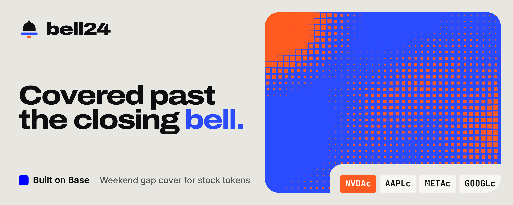</p>

<p align="center"><b>Protect your stock tokens while Wall Street is closed.</b><br>Built on Base for Base Stocks Maxxing, Programmable Stock Markets track.</p>

<p align="center"><a href="https://bell24.vercel.app"><b>bell24.vercel.app</b></a></p>

<p align="center">
  
</p>

## What it is

Coinbase's stock tokens on Base (NVDAc, AAPLc, METAc, GOOGLc) trade all weekend, but their Chainlink price freezes at Friday's close. Whatever happens over those 65 hours lands at Monday's open as a single jump.

bell24 lets holders keep the position and cover the jump. Switch on cover before the bell. If the stock reopens against you past your deductible, USDC lands in your wallet automatically. An agent prices every closure, and underwriters back the pool with USDC and keep the premiums when weekends are calm.

| Term | Meaning | Example |
|---|---|---|
| Covered amount | How much of the position is protected | $1,000 of NVDAc |
| Deductible | The part of the drop you absorb | First 5% |
| Limit | The largest drop covered | Up to 15% |
| Premium | The price for this closure, set by the agent | $1.80 this weekend |

**Payout = covered × (drop − deductible), capped at (limit − deductible).** A −9% open on $1,000 with a 5% deductible pays $40.

## Screens

<table>
  <tr>
    <td width="50%">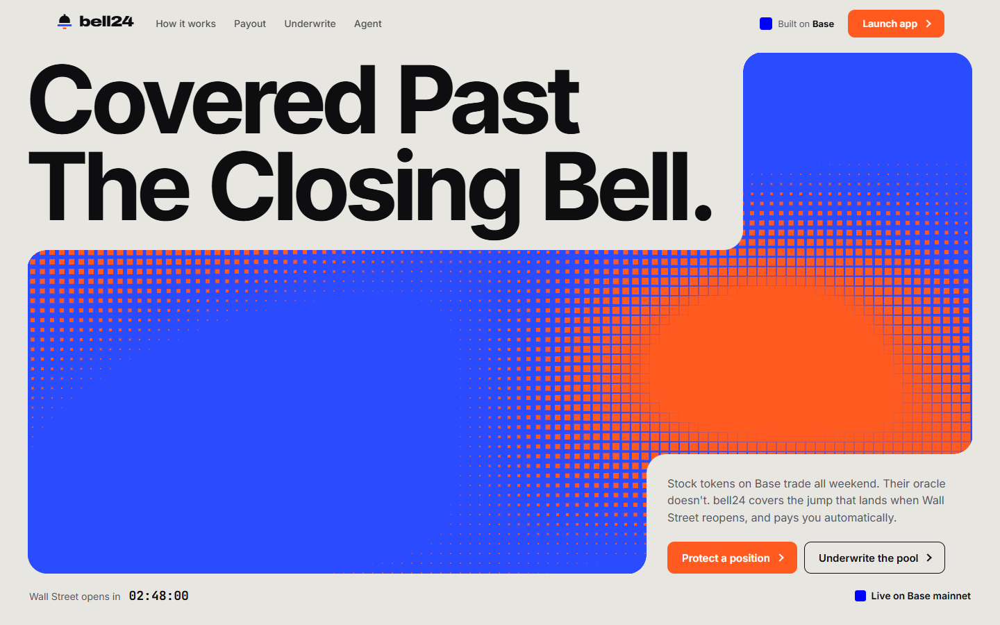</td>
    <td width="50%">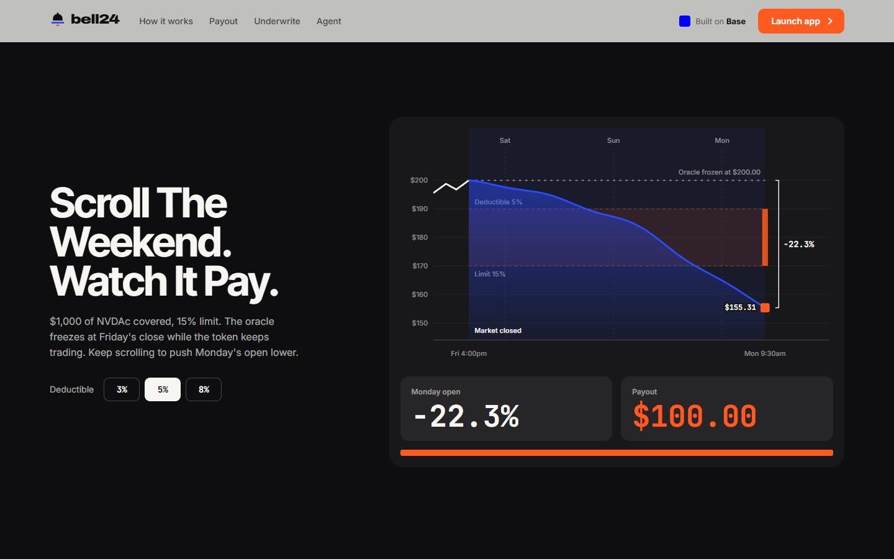</td>
  </tr>
  <tr>
    <td><b>Landing.</b> Square-cell halftone hero that follows the pointer and drifts with scroll.</td>
    <td><b>Payout.</b> A pinned section where scrolling pushes Monday's open lower and the payout counts up.</td>
  </tr>
  <tr>
    <td>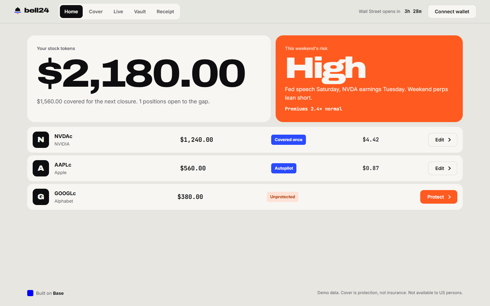</td>
    <td>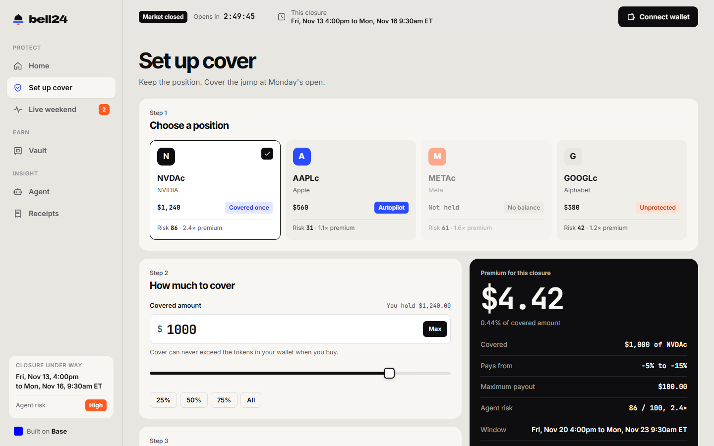</td>
  </tr>
  <tr>
    <td><b>Home.</b> Holdings, cover status and this weekend's risk note.</td>
    <td><b>Cover.</b> Amount, deductible, plan and a live quote with the payout table.</td>
  </tr>
  <tr>
    <td>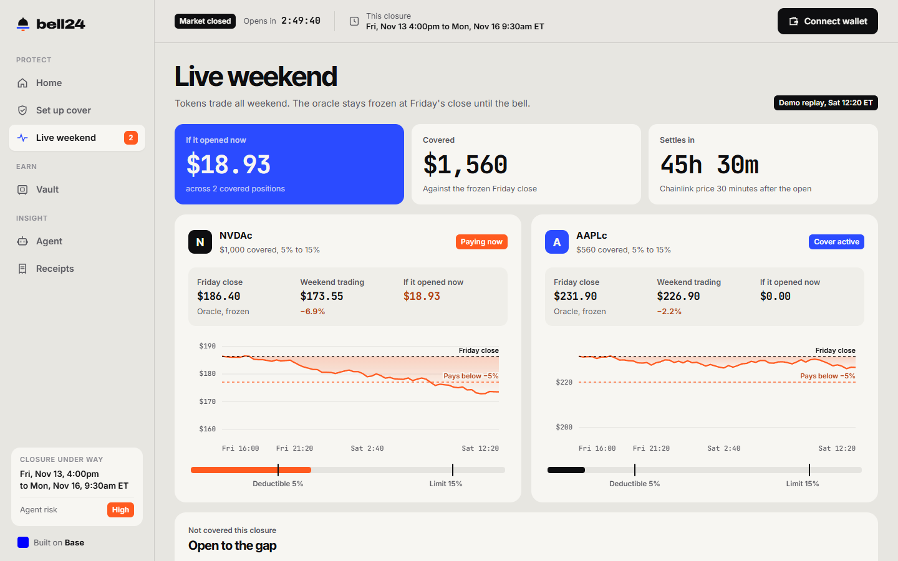</td>
    <td>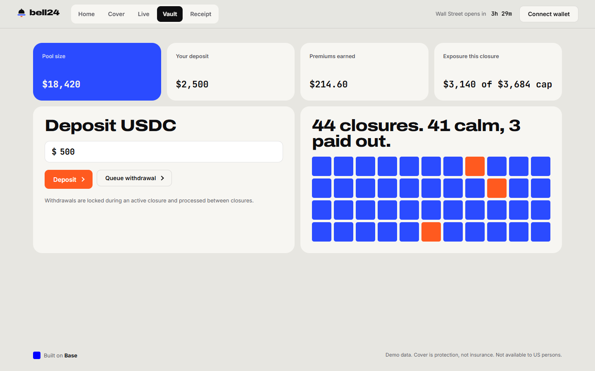</td>
  </tr>
  <tr>
    <td><b>Live.</b> Weekend trading against the frozen close, and the payout if it opened now.</td>
    <td><b>Vault.</b> Deposit USDC, see exposure and every past closure.</td>
  </tr>
</table>

<table>
  <tr>
    <td width="50%">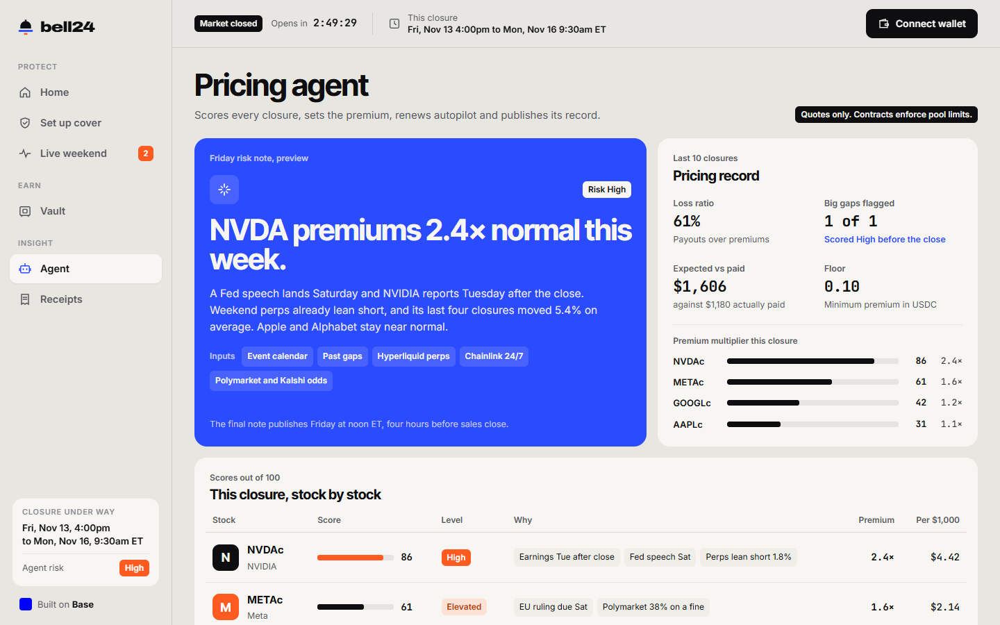</td>
    <td width="50%">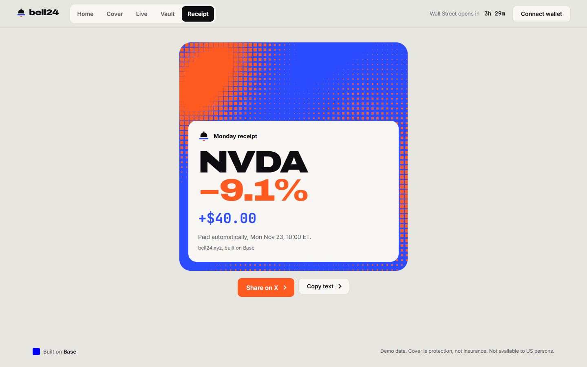</td>
  </tr>
  <tr>
    <td><b>Agent.</b> Friday risk note, pricing record and per-stock scores.</td>
    <td><b>Receipts.</b> The Monday card people share, and past payouts.</td>
  </tr>
</table>

## Run it

```sh
cd web
npm install
npm run dev
```

Vite, React 19, TypeScript, GSAP (ScrollTrigger, SplitText) and Lenis. The app at `/app` runs on demo data: the wallet, quotes and weekend prices are stand-ins until the contracts, the pricing agent and the Chainlink feeds are wired in.

```
web/src
  sections/      landing sections (Hero, Proof, Statement, GapScrub, Audience, Agent, Rules, Footer)
  app/           /app: shell/ (sidebar, top bar), screens/ (Home, Cover, Live, Vault, Agent, Receipts), ui/ (charts, tabs, switch, dialogs)
  components/    Logo, Halftone, Countdown, SplitReveal, Magnetic, Marquee, RollingNumber
  market.ts      market clock (New York hours) and the payout and premium maths
  motion.ts      one Lenis instance on GSAP's ticker
```

## Brand

<p align="center">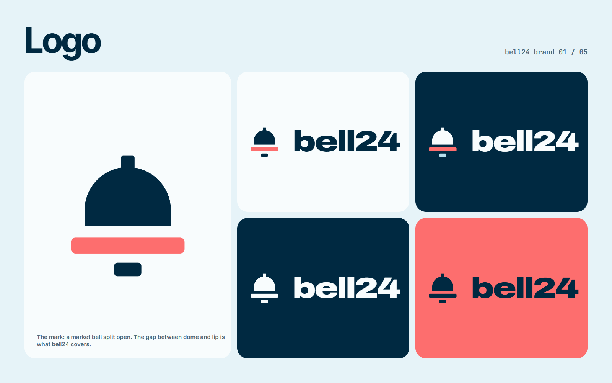 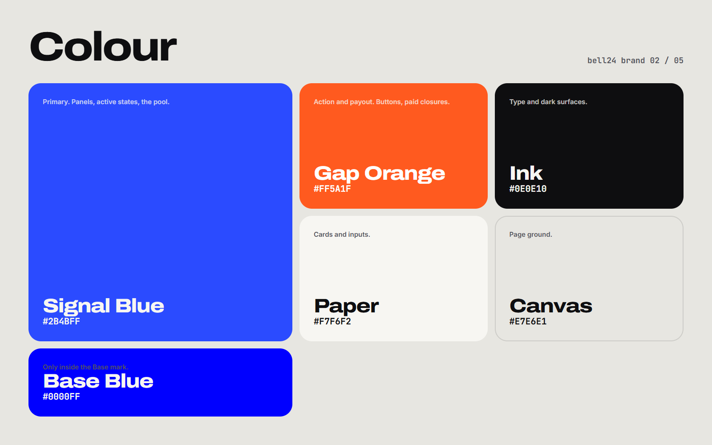</p>
<p align="center">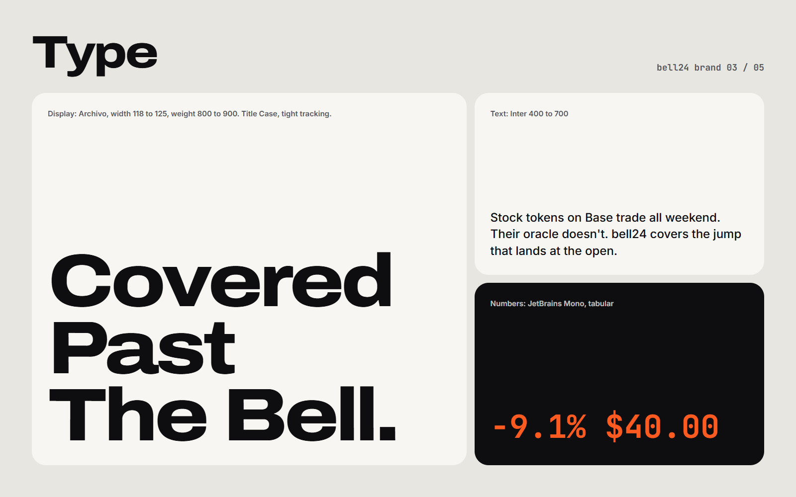 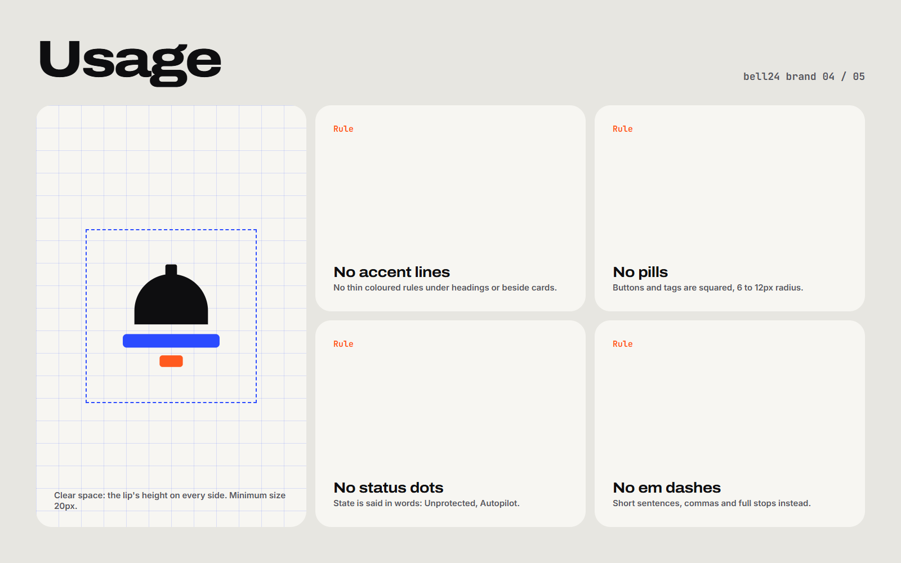</p>

Navy `#002941`, Coral `#FD6E6E`, Sky `#B6DFED`, with Paper `#F8FCFD` and Canvas `#E6F3F8` as neutrals. Inter Tight for display, Inter for text, JetBrains Mono for numbers, Archivo Expanded for the wordmark only. Logos, the kit, banners and social art live in [`brand/`](brand).

## Naming

It is called cover or protection, never insurance. Cover is capped at what the wallet holds, sales stop when the market closes, and the product is not offered to US persons.
