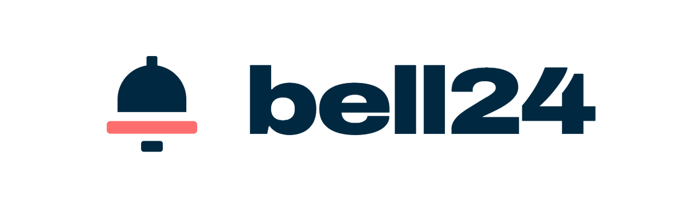

<p align="center"></p>

# bell24 brand

The mark is a market bell split open. The gap between the dome and the lip is the gap bell24 covers; the orange clapper is the payout.

| File | Use | Size |
|---|---|---|
| `logo/mark-{color,ink,white}.svg/.png` | the mark alone | 512×512, transparent |
| `logo/lockup-{color,ink,white}.svg/.png` | mark and wordmark | 1200×360, transparent |
| `logo/app-icon.svg/.png` | app and mini app icon | 1024×1024 |
| `banner.png` | README header | 1600×640 at 2× |
| `x-banner.png` | X header | 3000×1000 |
| `x-profile.png` | X and Telegram avatar, circle safe | 800×800 |
| `social/og.png` | link preview | 1200×630 |
| `kit/01..05-*.png` | logo, colour, type, usage, applications | 1600×1000 |

The lockup SVGs keep the wordmark as live Archivo text (loaded from Google Fonts); use the PNGs where fonts can't load.

## Colour and type

| Name | Hex | Use |
|---|---|---|
| Signal Blue | `#2B4BFF` | panels, active states, the pool |
| Gap Orange | `#FF5A1F` | actions, payouts, paid closures |
| Ink | `#0E0E10` | type, dark surfaces |
| Paper | `#F7F6F2` | cards, inputs |
| Canvas | `#E7E6E1` | page ground |
| Base Blue | `#0000FF` | only inside the Base mark |

Archivo (width 118 to 125, weight 800 to 900) for display in Title Case, Inter for text, JetBrains Mono for numbers. All three are SIL OFL.

## Rules

No accent lines, no pill shapes, no status dots, no em dashes. Buttons and tags are squared (6 to 12px radius) and state is written in words.

## Render

Plain HTML in `source/` (open in a browser to edit), exported by headless Edge:

```sh
cd brand
npm install
npm run render
```

`CHROME_PATH` points it at another Chromium.
